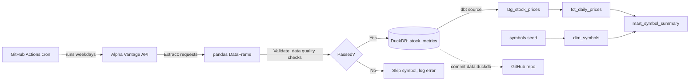

# Stock Market ELT Pipeline

An automated, serverless ELT (Extract, Load, Transform) pipeline that pulls daily stock prices from the [Alpha Vantage API](https://www.alphavantage.co/), validates them, loads them into a [DuckDB](https://duckdb.org/) warehouse, and builds analytics views on top. It runs on a schedule with GitHub Actions and commits the updated database back to this repository, so it costs nothing to operate.

## Architecture



## Features

- **Multi-symbol extraction** of KO, AAPL, MSFT, JPM and XOM, spread across sectors and paced to stay within the API's free-tier rate limit.
- **History backfill.** Each run loads the last ~100 trading days per stock, so a fresh database has useful history after one run.
- **Data quality checks** run before anything is loaded: no nulls, positive prices, high ≥ low, non-negative volume, and no duplicate rows.
- **Idempotent incremental loads.** A composite primary key on `(date, symbol)` with `ON CONFLICT DO NOTHING` means rerunning never creates duplicates.
- **Fault isolation.** If one symbol fails, the others are still loaded. The run only fails if every symbol fails.
- **dbt transform layer** with staging and mart models, a sector dimension built from a seed, and window functions for daily returns, volatility, and 7-day and 30-day moving averages.
- **Warehouse tests and freshness checks.** 19 dbt tests cover keys, grain, referential integrity, and price sanity. A source freshness check warns if the raw data is more than 3 days old.
- **CI/CD orchestration** with GitHub Actions on a weekday schedule, with a manual trigger as well.
- **Secrets management.** The API key comes from a local `.env` file or a GitHub repository secret and is never committed.

## Tech Stack

| Layer | Tool | Version |
|---|---|---|
| Language | Python | 3.14 |
| Source | Alpha Vantage REST API (`TIME_SERIES_DAILY`) | n/a |
| Extraction | `requests` | 2.34.2 |
| In-memory processing | `pandas` | 3.0.6 |
| Warehouse | DuckDB (embedded, columnar) | 1.5.6 |
| Transformation | `dbt-core` with `dbt-duckdb` | 1.12.6 / 1.11.0 |
| Orchestration | GitHub Actions (cron) | n/a |
| Config | `python-dotenv` | 1.2.4 |
| Testing | `pytest` | 9.1.1 |

All Python dependencies are pinned in `requirements.txt` so every run, locally or in CI, installs the same versions.

## Data Model

**`stock_metrics`** (table, raw layer): one row per stock per trading day.

| Column | Type | Description |
|---|---|---|
| `date` | DATE | Trading day (part of the primary key) |
| `symbol` | VARCHAR | Ticker symbol (part of the primary key) |
| `open_price` | DOUBLE | Opening price |
| `high_price` | DOUBLE | Daily high |
| `low_price` | DOUBLE | Daily low |
| `close_price` | DOUBLE | Closing price |
| `volume` | BIGINT | Shares traded |
| `loaded_at` | TIMESTAMP | UTC time the row was loaded |

The dbt project in `transform/` builds these models on top of the raw table:

| Model | Layer | Grain | Purpose |
|---|---|---|---|
| `stg_stock_prices` | Staging (view) | Symbol per trading day | Renames `date` to `trade_date` and standardizes symbols |
| `dim_symbols` | Mart (table) | Symbol | Company name, sector, and industry from the `symbols` seed |
| `fct_daily_prices` | Mart (table) | Symbol per trading day | Prices plus `daily_return`, `intraday_range_pct`, and 7-day and 30-day moving averages |
| `mart_symbol_summary` | Mart (table) | Symbol | Date range, latest close, period high and low, average volume, and daily volatility, joined to sector |

Column descriptions live in the `.yml` files next to each model, and `dbt docs generate` turns them into a browsable site with a lineage graph.

## Project Structure

```
Stock-Market-ELT-Pipeline/
├── .github/workflows/elt.yml   # Scheduled GitHub Actions workflow
├── data/data.duckdb            # DuckDB warehouse (updated by the pipeline)
├── pipeline.py                 # Extract, validate, load
├── transform/                  # dbt project
│   ├── dbt_project.yml
│   ├── profiles.yml            # Points dbt at data/data.duckdb
│   ├── models/staging/         # Source definition and stg_ models
│   ├── models/marts/           # dim_, fct_ and mart_ models
│   ├── seeds/symbols.csv       # Ticker to sector reference data
│   ├── macros/                 # Custom generic tests
│   └── tests/                  # Singular data tests
├── view_data.py                # Prints the mart tables
├── requirements.txt
└── README.md
```

## Getting Started

### 1. Get an API key

Sign up for a free key at [https://www.alphavantage.co/support/#api-key](https://www.alphavantage.co/support/#api-key).

### 2. Set up locally

```bash
git clone <your-repo-url>
cd Stock-Market-ELT-Pipeline
python -m venv .venv
# Windows
.venv\Scripts\activate
# macOS / Linux
source .venv/bin/activate
pip install -r requirements.txt
```

Create a `.env` file in the project root:

```
ALPHA_VANTAGE_API_KEY=your_key_here
```

### 3. Run the pipeline

```bash
python pipeline.py
```

### 4. Build the dbt models

```bash
cd transform
dbt build --profiles-dir .
cd ..
```

`dbt build` loads the seed, builds every model, and runs all tests. To browse the documentation and lineage graph, run `dbt docs generate --profiles-dir .` and then `dbt docs serve --profiles-dir .`.

### 5. View the data

```bash
python view_data.py
```

Or query it yourself:

```python
import duckdb
con = duckdb.connect("data/data.duckdb", read_only=True)
con.sql("""
    SELECT symbol, trade_date, close_price, ROUND(daily_return * 100, 2) AS pct_change
    FROM fct_daily_prices
    WHERE trade_date = (SELECT MAX(trade_date) FROM fct_daily_prices)
    ORDER BY pct_change DESC
""").show()
```

## Automation (GitHub Actions)

The workflow in `.github/workflows/elt.yml`:

1. Runs Monday to Friday at 22:00 UTC, after the US market closes, or on demand from the **Actions** tab.
2. Installs dependencies and runs `pipeline.py` using the `ALPHA_VANTAGE_API_KEY` repository secret.
3. Runs `dbt source freshness` and `dbt build`. If any dbt test fails, the run stops and the database is not committed.
4. Commits the updated `data/data.duckdb` with `[skip ci]` so the commit doesn't trigger another run.

To enable it, go to **Settings → Secrets and variables → Actions → New repository secret** and add `ALPHA_VANTAGE_API_KEY`.

## Design Decisions

- **ELT instead of ETL.** Raw daily prices are stored as they arrive, and the analytics are built in dbt. That keeps the raw history intact and makes transforms easy to change without reloading data.
- **DuckDB.** It's a columnar engine built for analytical queries, has no server to run, and the whole warehouse is a single file that can be versioned in git.
- **Rate-limit awareness.** The Alpha Vantage free tier allows 5 requests per minute and 25 per day. The pipeline waits 15 seconds between symbols, and five symbols on weekdays uses 5 requests per run, which leaves room for manual runs.

## Roadmap

- [ ] Add `pytest` unit tests for `validate_data` and the load step
- [x] Move transforms into **dbt** models with tests and documentation
- [ ] Publish dbt docs to GitHub Pages
- [ ] Add more sources, such as company profiles and fundamentals (Alpha Vantage `OVERVIEW`) and macro indicators (CPI, Treasury yields)
- [ ] Build a dashboard (Streamlit or Evidence) on top of the mart models
- [ ] Add failure alerts (email or Slack) from GitHub Actions
- [ ] Move storage to cloud object storage (S3 or MotherDuck) instead of committing the database file

## Author

**Kyler Bailey**: aspiring Data Engineer. This is the first project in my data engineering portfolio.
